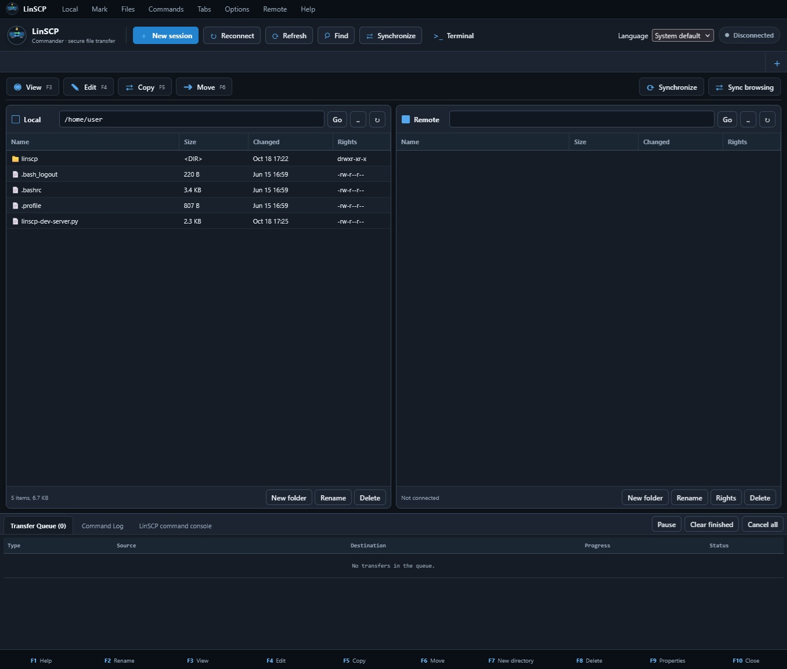

<p align="center">
  
</p>



# LinSCP

LinSCP is a noncommercial file transfer client for Debian GNU/Linux. It has
a command-line client with a WinSCP-style scripting language, and a
browser-based dual-pane Commander (`linscp-gui`).

LinSCP implements a subset of WinSCP's workflows. It is **not full WinSCP
parity**: see [Protocols](#protocols) and the [parity audit](docs/upstream-parity.md).

## Requirements

- Debian 13 (trixie) or newer, with a GCC or Clang toolchain.
- Build dependencies: `libssh-dev`, `libssl-dev`, `libargon2-dev`, `zlib1g-dev` and `pkg-config`.
- `curl` at run time, for FTP transfers, FTPS, WebDAV and S3.
- Python 3, for the graphical client.
- Node 20.19 or newer with `npm`, for the optional browser test suites
  (`npm install jsdom@29`). Not needed to build or use the client.

```sh
sudo apt install build-essential dpkg-dev pkg-config \
  libssh-dev libssl-dev libargon2-dev zlib1g-dev curl python3
```

LinSCP is Linux-only. The Makefile refuses to build on other systems.

## Building and testing

```sh
make -C source/linux                 # -> source/linux/build/linscp
make -C source/linux check           # unit tests and the platform check
make -C source/linux check-live      # script and live-server suites
```

CMake builds the same client and registers the suites with CTest:

```sh
cmake -S . -B build && cmake --build build -j
ctest --test-dir build --output-on-failure
```

The live suites use optional Python packages: `paramiko` (SFTP),
`botocore` (S3 signature reference), and `pyftpdlib` with `pyOpenSSL`
(FTP/FTPS). The SCP suite needs `openssh-server`; it starts its own `sshd` on a
free port. A suite that skips a case says so on its evidence line.

The GUI suites (`source/gui/tests/`) run separately, as in CI. The two browser
suites (`ClientTest.js`, `LocalizationTest.js`) are the ones that need Node and
`jsdom`; CMake registers them only when both are installed. `SecurityTest.py`
drives the server itself, with no browser: tokens, sign-in, the absence of CORS
permission, response headers, command quoting, and the confinement of every
local path to its pane.

`make -C source/linux check` also runs `tools/check_platform_conversion.py`.
LinSCP is a Linux-only client - the Windows port is gone - and that check
reads the sources and refuses a Windows API call, a Windows environment
variable, a Windows path, a file of another platform, an installer that
disagrees with the others, and an error message whose wording contradicts the
template it is filled into. It is what keeps the conversion complete rather
than merely done once. For the Debian package:

```sh
dpkg-buildpackage -b -us -uc         # -> ../linscp_1.0-4_<arch>.deb
```

## Usage

```sh
linscp -batch -script=script.txt
linscp -batch -command="open sftp://user@example.com/; cd /data; get *.csv /tmp"
linscp-gui                         # browser Commander on 127.0.0.1:8080
```

Run `linscp -help` for the options and `man linscp` for the full reference.

## Protocols

| URL | Served by | Notes |
| --- | --- | --- |
| `sftp://` | native SFTP v3 over libssh (copy-data / check-file-name extensions included) | full command set |
| `scp://`, `ssh://` | the client's SSH code: the server's shell for directory work, rcp for bytes | no resume; the protocol has no offset |
| `ftp://` | native FTP engine for listing and metadata; curl for transfers | |
| `ftps://` | curl, implicit TLS; `ftp://` with explicit TLS settings also uses curl | |
| `dav://`, `webdav://` | curl, with PROPFIND, MOVE, COPY, locks, dead properties and ETag preconditions | |
| `s3://` | curl, with SigV4 signing and multipart transfers | partial |

Host keys are verified. `-hostkey=` takes a SHA-256 or MD5 fingerprint. An
unknown key in a run that cannot prompt is refused, and the key is printed so
it can be pinned.

## Features

- **Transfers:** binary, ASCII and automatic modes; WinSCP file masks; recursive
  `get` and `put`; resume through `.filepart` staging; `-append` (SFTP only);
  `-speed=` limits; `-preservetime`; transfer presets.
- **Synchronization:** `synchronize` in one or both directions, and
  `keepuptodate`, which watches the local tree with inotify.
- **SSH keys:** native PPK v2/v3 parsing for authentication and `copyid`,
  including encrypted keys (Argon2 for encrypted v3), plus
  `linscp -convertkey=input.ppk -output=output.pem` for a validated PEM copy;
  encrypted inputs stay encrypted with the same passphrase.
- **Remote operations:** `chmod` (octal and symbolic), `cp`, `mv`, `ln`,
  `rm`, `mkdir`, `stat`, `checksum`, `edit`, `call`, and `copyid`.
- **Scripting:** unambiguous command and option abbreviations, `%1%`..`%9%`
  parameters, `%TIMESTAMP%` and environment expansion, `option batch` and
  `option confirm`, and an XML action log (`-xmllog=`).
- **Stored sessions:** shared between the CLI and the GUI, with folders,
  encrypted passwords in `sessions.key`, and proxy settings through
  `-rawsettings`.
- **Graphical client:** dual-pane layout, transfer queue with pause, retry and
  priority reordering, transfer settings, sync preview, `keepuptodate`, remote
  search, checksums, properties, saved command templates, multi-user sign-in,
  local file editing and drag-and-drop in both panes.
- **Localization:** English and Spanish, for the CLI and the GUI.

Not implemented: the .NET assembly API, GSSAPI, and SSH tunnel configuration.
`automation/LinSCP.psm1`, a PowerShell 7 wrapper over the CLI, is installed by
the Makefile, by CMake and by the Debian package, but no automated test runs
it.

## Documentation

- [`docs/debian.md`](docs/debian.md): options, commands, protocols,
  authentication, packaging and troubleshooting.
- [`docs/linscp.1`](docs/linscp.1): the manual page.
- [`docs/upstream-parity.md`](docs/upstream-parity.md): the parity audit, its
  evidence rules and how to maintain them.
- [`docs/linux-feature-inventory.md`](docs/linux-feature-inventory.md) and
  [`docs/remaining-parity-plan.md`](docs/remaining-parity-plan.md): generated
  from `docs/upstream-parity.json`. Regenerate them with
  `python3 tools/check_upstream_parity.py --write-report`.
- [`docs/localization.md`](docs/localization.md): language selection and catalogues.

## Repository layout

```
automation/    PowerShell 7 wrapper over the CLI (not tested)
debian/        Debian packaging
docs/          documentation, manual page and parity inventory
logo/          logo artwork
source/gui/    browser Commander: Python server, web client, tests
source/linux/  linscp client: front end, protocol glue, tests, Makefile
source/linux/  console client: libssh transport, native SFTP/SCP
tools/         parity inventory, translation and platform-conversion checkers
```

## Licence

LinSCP is distributed under the [PolyForm Noncommercial License
1.0.0](https://polyformproject.org/licenses/noncommercial/1.0.0):
noncommercial use only. This is not an open source licence. The full terms are
in [`LICENSE`](LICENSE); the copyright line, the MIT notice for the
third-party components and the artwork terms are in [`NOTICE`](NOTICE).
